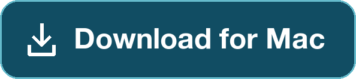

# GlassDock

GlassDock lets your wallpaper show through the macOS menu bar and the bottom Dock. Each has its own switch. Your Dock icons, minimized windows, and keyboard shortcuts keep working as usual.

[](docs/media/dock-demo.mp4)

<a href="https://github.com/vjachikslavny-crypto/glassdock/releases/latest/download/GlassDock.dmg"></a>

macOS 15 or later · Apple silicon and Intel · [Watch the 10-second demo](docs/media/dock-demo.mp4) · [SHA-256 checksum](https://github.com/vjachikslavny-crypto/glassdock/releases/latest/download/GlassDock.dmg.sha256) · [All releases](https://github.com/vjachikslavny-crypto/glassdock/releases)

## Installation

1. Open **GlassDock.dmg**, drag **GlassDock** to **Applications**, and launch it.
2. Turn on **Menu bar**, **Dock**, or both. macOS prompts for the permissions each effect needs.
3. To restore your selection after signing in, enable **Start selected effects at login**. Closing the GlassDock window leaves the effects running. Open it again to turn them off.

The app follows your Mac’s language by default. Use **Language** in the main window to choose **English** or **Русский**. The controls change immediately and remember your choice. The Dock helper uses your choice the next time you enable the effect. Sheer uses its own available translations.

The downloadable build is not notarized by Apple. If Gatekeeper blocks the first launch, Apple documents the **Open Anyway** option in **System Settings → Privacy & Security**. [Apple’s guide to opening Mac apps](https://support.apple.com/en-us/102445)

### Updating

Replace the app in **Applications**. If the Dock effect is running, turn it off and on again in the new version to load the bundled helper. If macOS asks for Screen Recording access, the Dock helper appears as **GlassDock**. Older versions may appear as **GlassDock Dock** or **Прозрачный Dock**. If you need to add the current helper manually, its path is `~/Library/Application Support/GlassDock/Helpers/GlassDock.app`.

## How it works

**Menu bar.** GlassDock uses [Sheer 1.3.1](https://github.com/AzurLiu/sheer) on macOS 15. Sheer needs Accessibility permission to read menu titles and can request Screen Recording access for live wallpapers. GlassDock uses an existing installation of Sheer or installs a copy alongside its Dock helper. On macOS 26 and later, the system provides menu bar transparency and GlassDock disables this switch.

**Dock.** The effect works with the Dock at the bottom of the main display. GlassDock uses ScreenCaptureKit to take snapshots of the Dock and exposed wallpaper when the Dock layout, desktop, or wallpaper changes. It preserves nearby window shadows and excludes window interiors from the wallpaper capture. Between updates it keeps the result in memory. Screen Recording permission is required, audio capture is disabled, and macOS may briefly show its capture indicator during an update.

- When a window sits behind part of the Dock, that part keeps the system background.
- During minimization or restoration from a thumbnail, GlassDock temporarily shows the system Dock so moving icons stay aligned. Transparency returns when the icons settle and the pointer clears the Dock.
- With Dock magnification enabled, the system background appears on hover. To keep transparency on hover, use **Open Dock settings** in GlassDock and turn off **Magnification**.
- After you unlock your Mac, GlassDock waits for the wallpaper transition to finish. The wallpaper stays still between snapshots, and a changed notification badge may only appear in full on the next refresh.

The universal binary contains both arm64 and x86_64 builds. It has been tested on an Apple silicon Mac running macOS 15.6.1. The Intel build has been verified in the disk image.

## Build from source

Build on macOS with Xcode Command Line Tools and the macOS 15 SDK or later.

```sh
bash build.sh
```

The universal disk image and its SHA-256 checksum appear in `build/`. The build fetches the pinned Sheer archive, verifies its checksum and signature, and bundles the original app and its license. For an offline build, set `SHEER_RELEASE_ZIP` to a local copy of that archive. [Sheer license](upper/LICENSE.Sheer)
