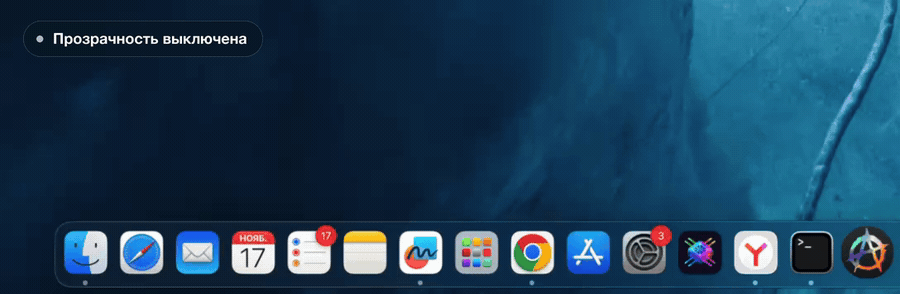

# GlassDock

macOS 15 и новее · Apple Silicon и Intel · [Строка меню и Dock в действии (10 секунд)](docs/media/dock-demo.mp4)

GlassDock показывает обои за строкой меню и между значками нижнего Dock. В окне приложения два отдельных переключателя. Можно включить один эффект, оба или выключить их в любой момент.

[Контрольная сумма SHA-256](https://github.com/vjachikslavny-crypto/glassdock/releases/latest/download/GlassDock.dmg.sha256) · [Все версии](https://github.com/vjachikslavny-crypto/glassdock/releases)

### Установка

1. Открой образ и перетащи **GlassDock** в **Программы**.
2. Запусти GlassDock и включи «Строка меню», «Dock» или оба переключателя.
3. При первом включении macOS может запросить разрешение для выбранного компонента. Для восстановления выбора после перезагрузки включи «Запускать выбранные эффекты при входе».

При обновлении с предыдущей версии замени приложение в «Программах». Открой новую версию и, если переключатель Dock уже включён, выключи и снова включи его. В запросе записи экрана для нижнего Dock приложение называется **GlassDock**. При необходимости открой «Конфиденциальность и безопасность» → «Запись экрана и системного звука» и добавь `~/Library/Application Support/GlassDock/Helpers/GlassDock.app`. У предыдущей версии в списке могло быть имя «Прозрачный Dock» или «GlassDock Dock».

Публичная сборка выпускается без нотарификации Apple. При предупреждении о неизвестном разработчике macOS позволяет подтвердить запуск конкретного приложения в разделе «Конфиденциальность и безопасность». [Инструкция Apple](https://support.apple.com/ru-ru/102445)

### Совместимость и разрешения

- Образ содержит версии для **Apple Silicon и Intel**. Проверено на Apple Silicon с macOS 15.6.1 Sequoia. На Intel проверена сборка. Минимальная версия macOS — 15.0.
- **Верхняя строка** работает через Sheer 1.3.1. Ему нужен «Универсальный доступ». Для живых обоев macOS также запрашивает доступ к записи экрана. На macOS 26 и новее верхняя строка уже поддерживает прозрачность. [Sheer](https://github.com/AzurLiu/sheer)
- **Нижний Dock** рассчитан на нижний край основного экрана. После изменения его состава, рабочего стола или обоев GlassDock запрашивает разовые снимки нижней полосы Dock и видимых участков обоев. На этих участках сохраняются тени соседних окон. Границы окон исключаются из области снимка фона. В простое картинка остаётся в памяти, захват завершается. При обновлении macOS может ненадолго показать фиолетовый индикатор. Для снимков требуется разрешение «Запись экрана и системного звука». Звук отключён.
- При наведении на область кнопок окна, сворачивании кнопкой «−» и открытии миниатюры рядом с Корзиной GlassDock временно показывает системный Dock. Если при открытии миниатюры значки сдвинулись под курсором, прозрачность вернётся, когда курсор покинет Dock и значки займут свои места. Это также работает при выключенном увеличении значков.
- При включённом увеличении значков Dock прозрачен, пока курсор в стороне. При наведении появляется обычный фон macOS. После ухода курсора прозрачность возвращается, когда значки уменьшатся. Чтобы сохранить прозрачность и при наведении, нажми «Открыть настройки Dock…» и передвинь ползунок увеличения до упора влево.
- Там, где за Dock находится окно приложения, остаётся системный фон. После разблокировки программа ждёт окончания перехода обоев. Между обновлениями фон в Dock остаётся неподвижным, а новый счётчик уведомлений на значке иногда полностью проявляется при следующем обновлении.
- При включении нижнего Dock контроллер запускает копию GlassDock из `~/Library/Application Support/GlassDock/Helpers`. Для верхней строки он использует установленный Sheer или копирует его в ту же папку. Закрытие окна GlassDock оставляет запущенные эффекты на экране. Чтобы убрать их, снова открой GlassDock и выключи переключатели.

### Build from source

On macOS with Xcode Command Line Tools and the macOS 15 SDK or later, run `bash build.sh`. The universal disk image and its SHA-256 checksum appear in `build/`.

The build fetches the official, version-pinned Sheer archive, verifies its checksum and signature, and preserves its license with the bundled application. To build offline, set `SHEER_RELEASE_ZIP` to a copy of the same archive. [Sheer license](upper/LICENSE.Sheer)
